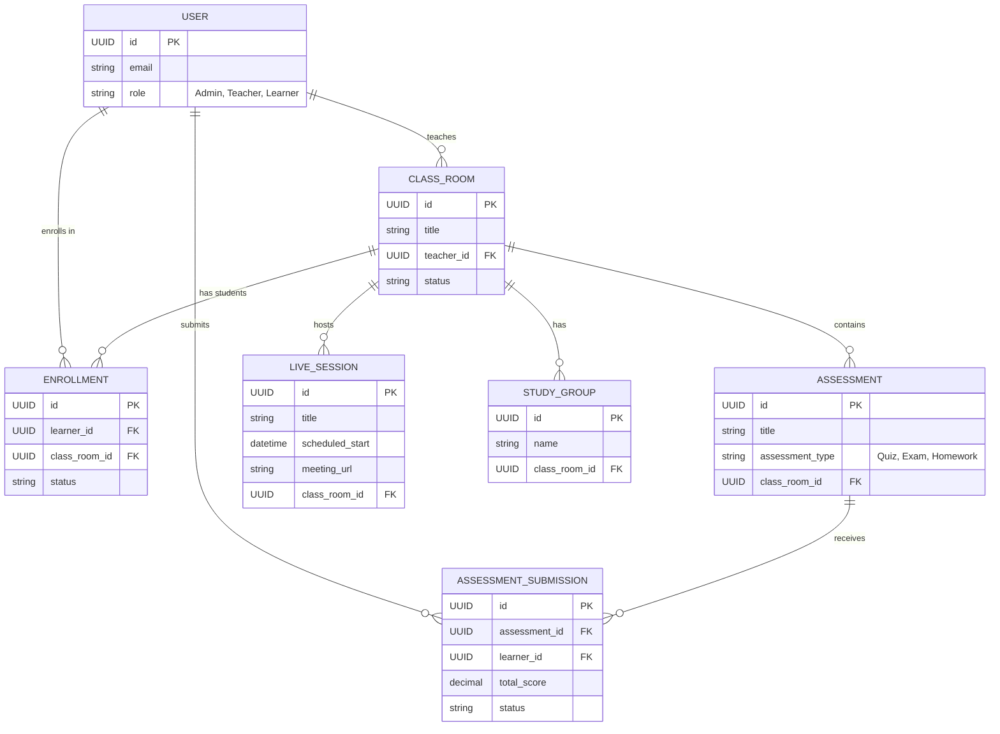

# KONNECT - Virtual Classroom

## Project Overview
KONNECT Virtual Classroom is a comprehensive virtual classroom and e-learning platform designed to facilitate online education, enhance student engagement, and provide seamless classroom management. The platform is built to support a robust interaction between Teachers, Learners, and Administrators.

## Core Modules & Features
The system is divided into several modular applications to handle different aspects of the e-learning experience:

1. **Accounts & Roles (`accounts`)**: 
   - Manages unified `User` authentication.
   - Distinct profiles and permissions for `TeacherProfile`, `LearnerProfile`, and `AdminProfile`.
2. **Class Management (`classes`)**: 
   - Teachers can create and manage `ClassRoom`s and set `ClassSchedule`s.
   - Learners join via `Enrollment` and can leave a `ClassRating`.
3. **Assessments (`assessments`)**: 
   - Supports creating Quizzes, Exams, and Homework (`Assessment`, `Question`, `QuestionOption`).
   - Tracks learner progress through `AssessmentSubmission` and `StudentAnswer`.
4. **Live Sessions (`live_sessions`)**: 
   - Manages virtual meetings (`LiveSession`), tracks `SessionAttendance`, and handles real-time `SessionChatMessage`.
5. **Collaboration (`collaboration`)**: 
   - Encourages peer-to-peer learning through `StudyGroup`s and `StudyGroupMessage`s.
   - Allows learners to create personal `StudyPlan`s.
6. **Communication (`communication`)**: 
   - Global and class-specific `Announcement`s.
   - Real-time `Notification`s and a `SupportTicket` system for issue resolution.
7. **Student Tracking & Gamification (`students`)**: 
   - Awards `Badge`s to learners to boost engagement.
   - Teachers can raise `LearnerFlag`s (e.g., Attendance Issue, Academic Struggle) to track and intervene when a student needs help.

---

## High-Level Architecture (Simplified ERD)
Below is a simplified Entity-Relationship Diagram highlighting the core data structures and how they interact. 
*(Note: Minor details, profiles, and granular tables like individual chat messages or single assessment questions have been abstracted for clarity).*

